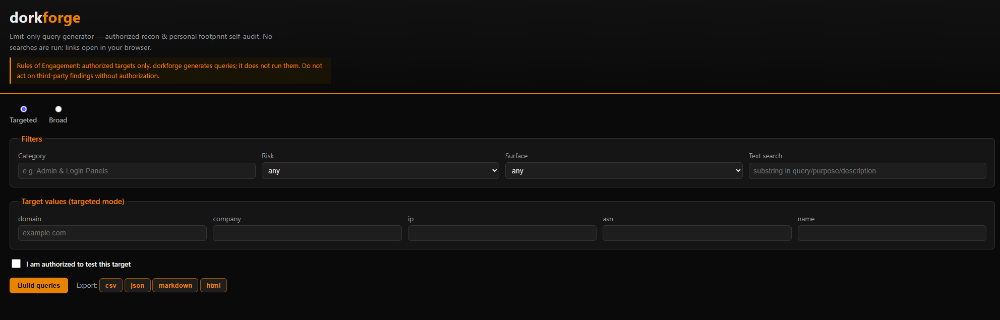

# dorkforge

Emit-only search-query generator for **authorized** security recon and
**personal footprint self-audit**. dorkforge turns a curated library of search
operators ("dorks") into ready-to-run query strings and clickable search URLs.

**Why:** good reconnaissance and footprint self-audit means knowing the right
search operators and composing them correctly. dorkforge keeps a curated,
categorized library and does that composition for you — and it stops there. It
**generates queries and never executes them**; you open the links yourself.

> **Status:** v0.1.0.

## What it does (and doesn't)

- ✅ Generates query strings and search-engine URLs you can open yourself.
- ❌ At runtime makes **no** network requests to search engines or targets. No
  scraping, and no HTTP client in its runtime dependencies.
- ❌ Live API execution (Google CSE, Shodan, …) is planned for v2 only, and
  would use official APIs — never scraping.

Use it only against scopes you own or are explicitly authorized to assess.

## Run modes

- **targeted** — requires a scope value (e.g. `example.com`, your own name).
  Requires you to confirm authorization (`--authorized`, or the checkbox in the
  web GUI).
- **broad** — no scope; generic operator queries. Results are internet-wide,
  third-party, research-only, and every row is tagged as such.

## Install

Install the CLI in an isolated environment with [pipx](https://pipx.pypa.io/),
from a local clone:

```bash
git clone https://github.com/suhhhdewd/dorkforge.git
cd dorkforge
pipx install .
dorkforge --help
```

For development (editable install with test and lint tools):

```bash
python -m venv .venv
.venv/Scripts/python -m pip install -e ".[dev]"   # Windows
# .venv/bin/python -m pip install -e ".[dev]"     # macOS/Linux
dorkforge --help
```

## Usage

```bash
# Summarize the library
dorkforge list

# Targeted queries (authorization required)
dorkforge build --authorized --target example.com --surface Google

# Broad queries (no scope value)
dorkforge build --broad --surface Shodan

# Export
dorkforge export --authorized --target example.com --format csv --out out.csv

# Local web GUI (binds to 127.0.0.1:8765)
dorkforge serve
```

## Screenshots

The local web GUI (`dorkforge serve`) in broad mode:



## Roadmap

Planned for **v2** — **not yet implemented**:

- **Live execution via official APIs** — run generated queries through official,
  authenticated provider APIs (e.g. Google Programmable Search / CSE, Shodan,
  Censys) behind the existing `executors/` interface. Never by scraping.
- **Person / self-search mode** — a guided footprint self-audit flow around your
  own names, handles, and domains.
- **Physical-recon module** — currently out of scope; if ever added it will be a
  clearly separated, opt-in module.

## Authorized use

dorkforge is a tool for **authorized** security work and **self-audit of your
own footprint**. It **only generates search queries and URLs; it never executes
them.** Opening a generated link, and anything you do with what you find, is
your action and your responsibility.

### Rules of Engagement

1. **Authorization first.** Only build targeted queries for assets you own or
   have explicit, current written authorization to assess. When in doubt, stop.
2. **This tool emits; it does not run.** dorkforge produces query strings and
   links. It performs no searches, no scraping, and no requests to targets.
3. **Passive by default.** Generated queries are for search engines. Do not use
   results to log into, probe, or otherwise actively touch a target without
   separate authorization.
4. **Broad results are third-party and research-only.** Broad mode strips
   scoping and returns internet-wide operator queries. Findings concern systems
   you are not authorized to test — do not act on them.
5. **Handle findings responsibly.** Document, do not exploit. Follow the target
   program's disclosure process. Respect each search provider's Terms of
   Service.
6. **Self-audit is for you.** Use targeted mode with your own name, handles, or
   domains to see your exposure — not to profile other people.

## Disclaimer

dorkforge is provided for lawful, authorized security testing and personal
footprint self-audit only. It generates search queries and URLs and does not
execute them or contact any target. You are solely responsible for how you use
the queries it produces and for ensuring you have authorization. The authors
accept no liability for misuse or for any damages arising from use of this
software. See [LICENSE](LICENSE) (MIT) and [SECURITY.md](SECURITY.md).

## Contributing

See [CONTRIBUTING.md](CONTRIBUTING.md). In short: any future live-execution
feature must use official provider APIs only and must never scrape search
engines.

## License

MIT — see [LICENSE](LICENSE).
